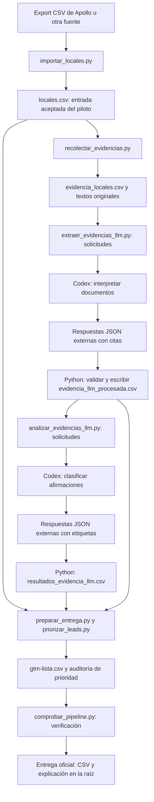

# Arquitectura del pipeline de prospección

## Propósito y alcance

Convertir un listado de candidatos en un CSV de prospectos priorizados para conversar sobre atención telefónica. El perfil objetivo es una cadena de EE. UU., de 2–15 locales y cocina casual de volumen.

**El perfil determina inclusión; la evidencia determina prioridad.** La falta de una captura o una señal telefónica deja investigación pendiente, sin eliminar al candidato del perfil. El puntaje expresa orden de contacto, no probabilidad de compra, ganancia esperada ni volumen de llamadas perdidas.

La aplicación es un conjunto de scripts Python y archivos CSV/JSON. Usa la biblioteca estándar, sin servidor, base de datos ni infraestructura de despliegue. La ejecución evaluada es asistida por Codex; el modo conectado a APIs existe por etapas, pero no está validado como proceso desatendido.

## Vista general



`comprobar_pipeline.py` coordina las etapas. Al faltar respuestas, exporta solicitudes y pausa para que Codex interprete desde la conversación. Después continúa con los archivos guardados. No invoca un modelo oculto ni importa interpretaciones del simulador anterior.

## Componentes y responsabilidades

| Componente | Responsabilidad | Entrada y salida |
|---|---|---|
| `importar_locales.py` | Normalizar un export existente y asignar IDs | Export → locales.csv. No exporta remotamente desde Apollo. |
| `recolectar_evidencias.py` | Preparar consultas y capturar páginas públicas | Website y enlaces → texto, URL, fecha y estado. |
| `extraer_evidencias_llm.py` | Preparar solicitudes, recibir respuestas y validar citas | Documentos → afirmaciones atómicas con evidencia. |
| `analizar_evidencias_llm.py` | Preparar clasificación y agregar etiquetas por empresa | Afirmaciones → indicadores y etiquetas trazables. |
| `llm_archivos.py` | Validar el contrato JSON y cargar respuestas externas | Solicitudes y respuestas identificadas por huella. |
| `priorizar_leads.py` | Aplicar reglas de inclusión y puntaje | Perfil e indicadores → candidatos, CSV y auditoría. |
| `preparar_entrega.py` | Generar la entrega desde archivos | Sin parámetros usa la comprobación actual; con rutas explícitas trabaja aislado. |
| `comprobar_pipeline.py` | Orquestar, verificar y actualizar la entrega oficial | Carpeta de ejecución → artefactos comprobados. |
| `tests/test_priorizacion.py` | Proteger el contrato de negocio | Pruebas de inclusión, prioridades y publicación. |

Los prompts están en `prompts/extraer_evidencias.md` y `prompts/clasificar_evidencias.md`. Sus versiones y huellas permiten reconocer cambios en el análisis.

## Contratos de datos y trazabilidad

| Archivo | Unidad y contenido |
|---|---|
| `locales.csv` | Candidato y sucursal de referencia: IDs, país, conteo de locales, web y contacto. En esta prueba se acepta como entrada, no como una nueva verificación de todas sus columnas. |
| `evidencia_locales.csv` | Documento o tarea de adquisición: relación con empresa/sucursal, URL, pasajes, fecha y estado. Incluye tareas pendientes y descargas fallidas. |
| `textos_originales/` | Texto completo extraído de descargas exitosas. Permite validar también contra el original de los pasajes seleccionados. |
| `solicitudes_*.json` | Prompt, esquema y entradas exactas para el LLM, con `request_id`. |
| `respuestas_*_codex.json` | Interpretaciones nuevas de Codex. Son datos de la ejecución, separados del código. |
| `evidencia_llm_procesada.csv` | Afirmación con `evidence_id`, cita literal, descripción, tema, alcance y fuente. |
| `resultados_evidencia_llm.csv` | Indicadores por empresa, estado y etiquetas por evidencia en JSON. |
| `auditoria_prioridad.json` | Inclusión, estado de evidencia, señales utilizadas y componentes del puntaje. |
| `gtm-lista.csv` | Prospectos incluidos, ordenados y con las 13 columnas requeridas. |
| `verificacion.json` | Resultado de controles y huellas de entradas, scripts y artefactos. |

`company_id` identifica la empresa y `location_id` la sucursal de referencia. Un `document_id` identifica el documento enviado al LLM; `evidence_id` vincula la afirmación con la clasificación. Los IDs no certifican la identidad comercial por sí solos.

Cada respuesta externa debe corresponder al `request_id` calculado para su entrada, prompt y modelo declarado. Una cita debe aparecer literalmente en el texto enviado; la comprobación también la busca en el texto completo descargado. La clasificación exige una etiqueta por evidencia, sin IDs omitidos o duplicados. Una cita literal válida no prueba por sí sola que una experiencia sea cierta ni valida toda la interpretación semántica.

## Adquisición y alcance real de la búsqueda

La comprobación nueva empieza únicamente desde Website de locales.csv. Sigue enlaces publicados del mismo dominio y prioriza FAQ, empleo, contacto, pedidos y ubicaciones. Esta corrida limitó la adquisición a tres páginas por candidato. Se conservan textos completos; el LLM recibe hasta 3.500 caracteres de pasajes seleccionados mecánicamente por palabras clave. Esa selección no genera conclusiones.

El recolector también puede preparar consultas o usar un proveedor de búsqueda configurado, pero ese camino no se ejecutó en esta comprobación. Las reseñas autorizadas son una entrada opcional y aquí están vacías. Los enlaces de Google Maps son referencias manuales; no alimentan los indicadores.

**Esta búsqueda tiene menos profundidad dirigida que el discovery original.** La investigación anterior consultó fuentes y avisos externos en varias rondas. Una cantidad mayor de descargas no garantiza recuperar las mismas páginas relevantes. Por eso algunas prioridades bajan o quedan pendientes, aunque la empresa siga incluida por perfil. Las fuentes históricas se preservan como respaldo y no se introducen silenciosamente en la ejecución nueva.

## Interpretación y modos de ejecución

**Modo comprobado con Codex.** Python exporta solicitudes estructuradas; Codex interpreta desde la conversación y guarda JSON. Python valida y agrega resultados. La primera interpretación se hizo con IA; repetir la corrida reproduce las respuestas registradas y no vuelve a razonar con un modelo.

**Modo API implementado por etapas.** Los dos scripts LLM admiten `--run` para enviar sus entradas al servicio configurado, con salida estructurada y caché. No se ejecutó ni verificó ese modo en el piloto. Tampoco se probó exportación por API de Apollo: el importador actual consume un archivo ya exportado. No se puede concluir que una cuenta nueva o un lote de miles de empresas esté resuelto sin supervisión.

**Modo histórico.** El simulador anterior contiene respuestas preparadas en código y el generador tiene un recorrido explícito `--legacy`. No intervienen en la comprobación actual. Las reproducciones históricas se escriben dentro de historico/, sin sustituir la entrega oficial.

## Inclusión, evidencia y prioridad

Son decisiones separadas:

1. **Inclusión:** el código controla país de EE. UU. y conteo de 2–15 sucursales sobre la entrada aceptada. Cocina y volumen no se vuelven a certificar automáticamente.
2. **Estado de evidencia:** con señal telefónica o con evidencia telefónica pendiente. Una descarga fallida mantiene la incógnita; no equivale a ausencia de necesidad.
3. **Prioridad:** regla `prioridad-v4`, calculada por Python desde señales clasificadas.

| Banda | Puntos | Interpretación |
|---|---:|---|
| Perfil sin evidencia telefónica | 10–14 | Prospecto incluido; validar el uso del teléfono. |
| Antecedente antiguo | 15–24 | Revalidar vigencia antes de priorizar. |
| Canal exploratorio | 30–49 | Pedidos, consultas o rol telefónico sin dificultad demostrada. |
| Hipótesis operativa | 50–69 | Tareas compartidas o canal de pedidos con presión operativa. |
| Dificultad explícita | 80–99 | La fuente describe una dificultad concreta del teléfono. |

Las bonificaciones usan presencia de canal, tareas y demanda; alcance de sucursal, texto disponible y recencia. Sus límites mantienen separadas las bandas. Si hubiera dificultades atribuidas a varias sucursales, se reconoce ese patrón; no se confunde el total de locales de una marca con locales afectados. Varias citas de una página no equivalen a incidentes independientes. El bono de recencia depende de la fecha de ejecución; este corpus no aporta fechas de publicación operativa para activarlo.

## Verificación y publicación de la entrega

El verificador compara el conjunto de prospectos con los candidatos que cumplen el perfil, no con un número 30 fijado en el código. Rechaza una salida que omita a un candidato válido. Las pruebas cubren ausencia total de evidencia, orden por señales, exclusión real por perfil y coherencia de la entrega oficial.

La comprobación actual evalúa 30 candidatos: todos quedan incluidos, 14 con señales telefónicas y 16 con evidencia pendiente. Hay 76 capturas con texto para 28 empresas y 56 afirmaciones clasificadas. Dos webs bloquearon la descarga. Se repitió el procesamiento en una copia aislada sin datos históricos, cachés ni salidas previas y con la red bloqueada; el CSV resultó idéntico.

La entrega oficial de la raíz se copia del resultado comprobado. `LISTA-EXPLICADA.md` se genera desde el mismo CSV y auditoría. Los comandos predeterminados no restauran el discovery anterior encima de la entrega actual.

```sh
python3 -m unittest discover -s tests -v
python3 scripts/comprobar_pipeline.py
python3 scripts/comprobar_pipeline.py --verify-only
```

Para adquisición e interpretación nuevas, usar otra carpeta y seguir la [guía completa](comprobacion_codex/README.md). Un clon incluye las capturas y respuestas para la reproducción sin API; excluye `.env`, cachés, logs locales y respaldos comprimidos. El resultado técnico comprobado no equivale a una validación comercial exhaustiva ni a un sistema desatendido de producción.
