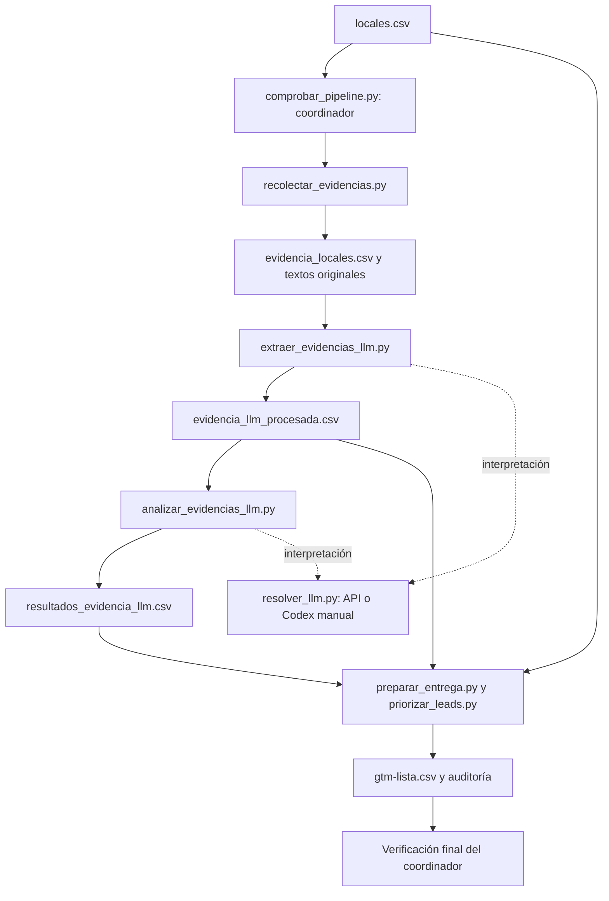

# Arquitectura del pipeline

El sistema transforma `locales.csv` en un CSV de leads priorizados. Usa scripts Python y archivos CSV/JSON, sin base de datos ni paquetes adicionales. La obtención del export de Apollo queda fuera del recorrido.

## Flujo y responsabilidades

`comprobar_pipeline.py` se ejecuta al principio y coordina todas las etapas. Cada script genera sus archivos; el coordinador comprueba el resultado al final.

| Etapa | Responsable | Qué hace |
|---|---|---|
| Entrada | `importar_locales.py`, antes del flujo | Normaliza un export existente y asigna IDs; no consulta Apollo. |
| Captura | `recolectar_evidencias.py` | Descarga páginas oficiales y registra textos, URL, fecha y fallos. |
| Extracción | `extraer_evidencias_llm.py` | Prepara solicitudes y valida las afirmaciones y citas devueltas por el LLM. |
| Clasificación | `analizar_evidencias_llm.py` | Prepara solicitudes para clasificar evidencias y agrega indicadores por empresa. |
| Interpretación | `resolver_llm.py` | Envía solicitudes a la API o prepara pendientes para Codex. Guarda respuestas y procedencia. |
| Entrega | `preparar_entrega.py` y `priorizar_leads.py` | Aplican inclusión y prioridad y escriben el CSV y su auditoría. |
| Coordinación | `comprobar_pipeline.py` | Ejecuta las etapas, registra avances y verifica consistencia. |

Los prompts están en [extracción](prompts/extraer_evidencias.md) y [clasificación](prompts/clasificar_evidencias.md). `llm_archivos.py` valida los esquemas JSON.

## Qué contiene cada archivo

| Archivo | Contenido |
|---|---|
| `locales.csv` | Empresas, IDs, país, sucursales, web y datos de contacto. Es la entrada aceptada del piloto. |
| `evidencia_locales.csv` | Documentos capturados y tareas pendientes, con texto seleccionado, URL, fecha y estado. |
| `textos_originales/` | Texto completo extraído de cada descarga exitosa. |
| `solicitudes_*.json` | Instrucciones, esquema y entradas exactas para el LLM. |
| `respuestas_*_codex.json` | Respuestas externas de API o Codex, relacionadas mediante `request_id`. |
| `evidencia_llm_procesada.csv` | Afirmaciones con cita literal, tema, alcance y fuente. |
| `resultados_evidencia_llm.csv` | Etiquetas e indicadores agregados por empresa. |
| `gtm-lista.csv` | Leads incluidos, ordenados y con las 13 columnas de la consigna. |
| `auditoria_prioridad.json` | Indicadores utilizados, inclusión y componentes del puntaje. |
| `estado_ejecucion.json` | Etapa, estado y actor de cada avance. |
| `ejecucion_llm.json` | Intentos de API y solicitudes pendientes de la invocación. |
| `verificacion.json` | Resultado de controles y huellas de los archivos. |

`company_id` relaciona la empresa; `location_id`, la sucursal de referencia; `evidence_id`, la afirmación y su clasificación. La identidad técnica no confirma por sí sola que una fuente corresponda a una sucursal.

## Adquisición e interpretación

El recolector comienza en `Website`, sigue enlaces del mismo dominio y prioriza FAQ, pedidos, contacto, empleo y ubicaciones. Intenta hasta tres páginas por empresa. Conserva el texto completo y selecciona hasta 3.500 caracteres de pasajes literales mediante términos como `phone`, `call`, `busy`, `peak`, `host` y `capacity`. Esa selección no genera conclusiones.

Las búsquedas externas y reseñas no están conectadas al recorrido predeterminado. Los enlaces de Google Maps sirven para revisión manual. La captura actual tiene menos profundidad que la investigación inicial, que consultó fuentes adicionales.

Con API disponible, el LLM realiza extracción y clasificación automáticamente. Si falla o falta configuración, el proceso guarda su avance y deja solicitudes para Codex. Codex solo interpreta esas entradas y escribe respuestas JSON; Python valida y genera los CSV. No se modifica el código ni se completa evidencia por fuera de ese contrato.

Las respuestas API registran proveedor, modelo real, identificador y uso de tokens en `metadata`. El nombre histórico `respuestas_*_codex.json` admite ambos proveedores. En los CSV intermedios, `model` identifica el contrato de la corrida; el modelo real se consulta en metadata.

## Inclusión y prioridad

El perfil determina inclusión; la evidencia determina prioridad. Python controla EEUU y 2–15 sucursales sobre la entrada aceptada. Cocina y volumen requieren validación comercial adicional. La cocina se toma del perfil o se infiere de su nombre, descripción o palabras clave; la procedencia queda registrada y no afecta el puntaje.

| Banda | Puntos | Interpretación |
|---|---:|---|
| Perfil sin evidencia telefónica | 10–14 | Posible cliente; validar el uso del teléfono. |
| Antecedente antiguo | 15–24 | Revalidar vigencia. |
| Canal exploratorio | 30–49 | Pedidos, consultas o rol telefónico documentado. |
| Hipótesis operativa | 50–69 | Tareas compartidas o canal con presión operativa. |
| Dificultad explícita | 80–99 | Dificultad telefónica publicada. |

La regla `prioridad-v4` suma bonificaciones limitadas por canal, tareas, demanda, alcance, texto y recencia. Reconoce problemas atribuidos a varias sucursales; no confunde el total de sucursales con las afectadas ni varias citas con incidentes independientes. El puntaje ordena el contacto, sin estimar ganancia o probabilidad de compra. La recencia depende de la fecha de ejecución; el corpus actual no aporta fechas para activarla.

## Ejecución y controles

| Modo | Comportamiento |
|---|---|
| Sin opciones de continuación | Corrida nueva en `ejecuciones/<fecha_id>/`: copia solo locales.csv y vuelve a capturar e interpretar. |
| `--resume --out-dir <carpeta>` | Continúa la misma corrida, conservando el progreso. |
| `--replay --out-dir <carpeta>` | Reproduce capturas y respuestas guardadas, sin API paga. |
| `--verify-only --out-dir <carpeta>` | Verifica los archivos existentes. |
| `--llm-mode codex` | Impide llamadas pagas durante una corrida nueva o su continuación. |

Una corrida nueva exige una carpeta vacía y solicitudes con identidad propia. Los controles rechazan respuestas ajenas, citas ausentes, clasificaciones incompletas, duplicados, pérdida de leads válidos y puntajes inconsistentes. Las huellas de código, prompts y fuentes impiden ocultar modificaciones durante esa corrida. El comando devuelve 0 al completar, 2 mientras espera a Codex y 1 ante error.

El CSV de una corrida nueva queda en su carpeta. La raíz conserva la entrega evaluada: reproducir explícitamente `comprobacion_codex` actualiza esa copia y su explicación. El modo `--legacy` del generador reproduce registros históricos aparte.

Se comprobó la ejecución asistida con Codex y se probaron corridas nuevas, cambios de entrada y recuperación mediante conexiones simuladas. No se probó una llamada paga real ni una ejecución desatendida de miles de empresas. Una cita literal válida demuestra trazabilidad, no garantiza toda la interpretación comercial.

Para comandos y continuación con Codex, seguí la [guía de ejecución](comprobacion_codex/README.md). Para resultados y documentos de entrega, el [README central](README.md).
